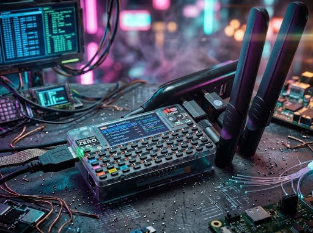

<div align="center">


# CardputerZero Wi-Fi USB Manager

**Cyberpunk-styled LVGL 9.5 utility for M5Stack CardputerZero (`APPLaunch`) to manage external USB Wi-Fi adapters and built-in wireless interfaces.**

*Created by **Adriano Dias Moraes** (`@adrianomoraes`) using Gemini Argon 4*

[](CHANGELOG.md)
[](https://github.com/adrianomoraes/CardputerZero-WiFiManager)
[-FF007F?style=for-the-badge)](https://github.com/adrianomoraes/CardputerZero-WiFiManager)
[-8A2BE2?style=for-the-badge)](https://lvgl.io/)

<br />



</div>

---

## Overview

When plugging an external USB Wi-Fi dongle (such as a MediaTek `mt7601u`, Realtek, or Alfa adapters) into the **M5Stack CardputerZero**, Linux exposes multiple wireless interfaces (`wlan1`, `wlan2`, alongside the built-in Broadcom `wlan0`).

**CardputerZero Wi-Fi USB Manager** (`WiFi USB` in `APPLaunch`) provides a native, fast 320 × 170 graphical interface designed specifically for the CardputerZero's physical TCA8418 keyboard and MIPI/ST7789 LCD (`/dev/fb_lcd`) so you can:

- **Auto-detect & prioritize USB Wi-Fi adapters** (`[USB]` vs `[INT]` badges, reading real USB vendor/product strings and kernel drivers via `sysfs`).
- **Switch interfaces on the fly** (`wlan1` ↔ `wlan0`) and inspect per-adapter state, active SSID, and IPv4 address.
- **Scan 2.4 GHz & 5 GHz networks** on the selected adapter with live signal bars, security badges (`OPN` / `LCK`), channel info, and circular **marquee scrolling** for long SSIDs and adapter names.
- **Connect with per-adapter NetworkManager profiles** (`<ifname>-<ssid>`) so your USB adapter and built-in Wi-Fi can connect independently to the same or different networks without colliding.

---

## Quick Install (No Recompilation Needed!)

A precompiled ARM64 Debian package (`artifacts/wifi-manager_0.1.1-m5stack1_arm64.deb`) and prebuilt binary (`dist/M5CardputerZero-WiFiManager`) are included right in the repository.

### Option 1: Direct One-Line Install on the CardputerZero (Recommended)

Run this directly inside an SSH session or terminal on your **CardputerZero**:

```bash
curl -fsSL https://raw.githubusercontent.com/adrianomoraes/CardputerZero-WiFiManager/main/artifacts/wifi-manager_0.1.1-m5stack1_arm64.deb -o /tmp/wifi-manager.deb && sudo dpkg -i /tmp/wifi-manager.deb && systemctl --user restart APPLaunch.service
```

### Option 2: Clone & Install Directly on the CardputerZero

```bash
git clone https://github.com/adrianomoraes/CardputerZero-WiFiManager.git
cd CardputerZero-WiFiManager
./install_prebuilt.sh
```

### Option 3: Install Remotely from Your PC / Mac over SSH

*(Replace `192.168.x.x` with your CardputerZero's IP address and `pi` with your CardputerZero SSH username)*:

```bash
./install_prebuilt.sh 192.168.x.x pi
```

---

## Troubleshooting: Repairing a Broken `v0.1.0` AppStore Install

> [!NOTE]
> In `v0.1.0`, the Debian package `postinst` script ran `systemctl --user restart APPLaunch.service`. When installed from the on-device **CardputerZero AppStore**, restarting `APPLaunch.service` terminated the AppStore child process mid-installation, leaving `dpkg` in an interrupted state (`dpkg --configure -a` required).
>
> **`v0.1.1` fixes this completely.** If your device is currently blocked by the `v0.1.0` package repair message, run this one-liner on your CardputerZero terminal/SSH to repair `dpkg` and install `v0.1.1`:

```bash
sudo rm -f /var/lib/dpkg/info/wifi-manager.postinst && sudo dpkg --configure -a && curl -fsSL https://raw.githubusercontent.com/adrianomoraes/CardputerZero-WiFiManager/main/artifacts/wifi-manager_0.1.1-m5stack1_arm64.deb -o /tmp/wifi-manager.deb && sudo dpkg -i /tmp/wifi-manager.deb && systemctl --user restart APPLaunch.service
```

---

## Keyboard Controls

Designed for one-handed navigation on the CardputerZero keyboard without needing Shift/Fn chords:

| Key | Networks Screen | Adapter Selector Screen | Password Input Screen |
| :--- | :--- | :--- | :--- |
| **`F` / `X`** *(or `Up` / `Down`)* | Move selection Up / Down | Select Wi-Fi Adapter | — |
| **`Z` / `C`** *(or `Left` / `Right`)* | Switch active adapter (`wlan1` ↔ `wlan0`) | Select Wi-Fi Adapter | — |
| **`Tab`** *(or `A` / `I`)* | Open Adapter Selector screen | Confirm selected adapter | Toggle Show / Hide Password |
| **`Enter`** | Connect to selected network | Use selected adapter & scan | Connect with entered password |
| **`R`** | Rescan Wi-Fi networks on current adapter | Refresh adapter list | — |
| **`D`** | Disconnect active adapter | — | — |
| **`Backspace` / `K`** | Forget saved profile for selected SSID | — | Delete character (`Backspace`) |
| **`Esc`** *(short / hold)* | Exit app | Return to Networks screen | Cancel password input |

---

## Architecture & Project Layout

```text
CardputerZero-WiFiManager/
├── CHANGELOG.md                      # Release history & version notes
├── VERSION                           # Current semantic version (0.1.1)
├── applications/
│   └── wifi-manager.desktop          # APPLaunch desktop entry
├── artifacts/
│   ├── wifi-manager_0.1.1-m5stack1_arm64.deb  # Ready-to-install ARM64 Debian package
│   └── wifi-manager_latest_arm64.deb          # Latest stable ARM64 Debian package
├── dist/
│   └── M5CardputerZero-WiFiManager   # Precompiled ARM64 executable
├── main/
│   ├── include/
│   │   ├── compat/input_keys.h       # Evdev key definitions
│   │   ├── keyboard_input.h          # TCA8418 libinput + xkbcommon reader
│   │   └── wifi_backend.h            # sysfs + nmcli backend interface
│   └── src/
│       ├── keyboard_input.c          # Hardware matrix keyboard driver thread
│       ├── main.cpp                  # LVGL 9.5 320x170 UI & marquee views
│       └── wifi_backend.cpp          # USB/built-in adapter discovery & nmcli runner
├── scripts/
│   ├── build_deb.sh                  # Pure-Python local .deb package builder
│   └── generate_icon.py              # Fallback procedural icon generator
├── share/images/
│   └── wifi-manager.png              # 100x100 RGBA Cyber-Hologram Wi-Fi icon
├── config_defaults.mk                # LVGL 9.5 fbdev + evdev + TinyTTF config
├── deploy_cardputerzero.sh           # Full source sync, native SCons build & deploy
└── install_prebuilt.sh               # Zero-compile installer script
```

---

## Building from Source

If you modify the C++ source code (`main/src/main.cpp` or `main/src/wifi_backend.cpp`) and want to recompile and deploy directly using the CardputerZero's native AArch64 toolchain and cached `M5Stack_Linux_Libs` SDK:

```bash
CARDPUTER_ZERO_PASSWORD='<your-ssh-password>' ./deploy_cardputerzero.sh <cardputer-ip> <ssh-user>
```

To rebuild the `.deb` package locally (no SSH needed):

```bash
./scripts/build_deb.sh
```

---

## Author & License

- **Author**: **Adriano Dias Moraes** (`@adrianomoraes`)
- **License**: Released under the [MIT License](https://opensource.org/licenses/MIT).
